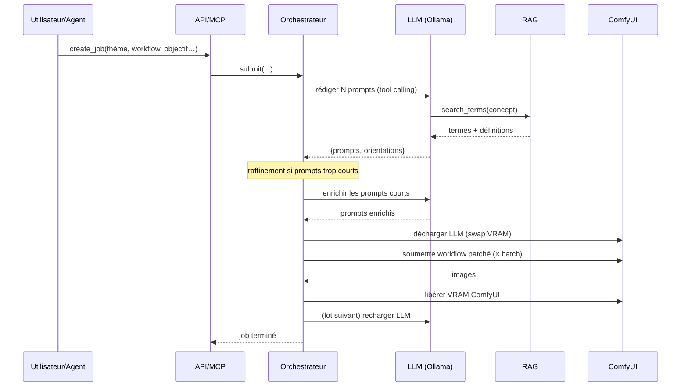
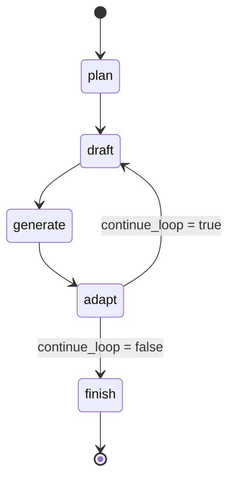

# Architecture technique — Prolific

> Document technique de référence. Pour l'utilisation, voir `README.md`.
> Pour le détail du schéma LangGraph, voir aussi `RAPPORT.md`.

---

## 1. Vue d'ensemble

Prolific est un **orchestrateur de génération d'images en masse** : il pilote un LLM
(Ollama) pour rédiger des prompts, et une instance ComfyUI pour générer les images.
Le principe fondateur : **l'application tient la boucle**, le LLM est un « cerveau »
stateless appelé ponctuellement — il n'est jamais laissé seul sur une durée.

```mermaid
flowchart TB
    subgraph Clients
        UI[Interface web]
        MCP[Agent MCP externe\n(pi, Claude…)]
    end

    subgraph Prolific
        API[API REST /api]
        ORCH[Orchestrateur LangGraph]
        AGENT[Agent de rédaction\nLLM ↔ outils]
        RAG[Index RAG\nChromaDB]
        TRACES[Traces JSONL]
        DB[(SQLite\njobs/images/calibration)]
    end

    subgraph Externes
        OLL[Ollama\nLLM + embeddings]
        COMFY[ComfyUI\ngénération]
    end

    UI --> API
    MCP --> ORCH
    API --> ORCH
    ORCH --> AGENT --> OLL
    AGENT --> RAG
    RAG -.embeddings.-> OLL
    ORCH --> COMFY
    ORCH --> DB
    ORCH --> TRACES
```

---

## 2. Composants

| Module | Rôle |
|--------|------|
| `main.py` | assemble tout, sert l'UI (`/`), l'API (`/api`), le MCP (`/mcp`) |
| `config.py` | config `config.yaml` (pydantic) |
| `db.py` | SQLite : jobs, images, calibration de durée |
| `clients/ollama.py` | génération, embeddings, température du modèle, déchargement |
| `clients/comfyui.py` | soumission, suivi, extraction, libération VRAM |
| `rag.py` | indexation CSV → ChromaDB, recherche, termes aléatoires |
| `prompting.py` | templates, normalisation, dédoublonnage, longueur |
| `agent.py` | boucle LLM ↔ outils, raffinement, conversation |
| `tools.py` | outil `search_terms` (tool calling) |
| `orchestrator.py` | machine à états LangGraph, swap VRAM, stop, traces |
| `workflows.py` | manifest ComfyUI + injection des slots |
| `traces.py` | traces JSONL (fine-tuning) + suppression |
| `api.py` | API REST (config, jobs, stop, suppression) |
| `mcp_server.py` | serveur MCP (outils v1) |

---

## 3. Cycle de vie d'un job



Deux modes d'objectif :
- **« N prompts »** : tout est rédigé en un lot, puis généré en un lot.
- **« T minutes »** : boucle *planifier → exécuter → adapter*, avec calibration de la
  durée moyenne par image.

---

## 4. Orchestrateur (LangGraph)

Le cœur est un `StateGraph` synchrone exécuté dans un thread d'arrière-plan.



- **`plan`** : dimensionne le lot (`N` prompts ou estimation via calibration).
- **`draft`** : rédige les prompts (LLM + outils + raffinement).
- **`generate`** : patch le workflow, génère (`batch` images par prompt), swap VRAM.
- **`adapt`** : met à jour la calibration, recalcule le lot suivant ou termine.
- **`finish`** : clôture le job en base.

**Checkpointing** : `SqliteSaver` (`checkpoints.sqlite`), un checkpoint par
`thread_id = job_id`. *(La vraie reprise après arrêt est en TODO — voir `TODO.md`.)*

**Stop** : un `threading.Event` consulté entre chaque image → le job se termine
proprement en `stopped`.

---

## 5. Rédaction de prompts

```mermaid
flowchart LR
    T[Thème + style + datasets] --> S[System prompt\n(templates)]
    S --> L[LLM + outils]
    L -->|tool_calls| R[search_terms]
    R -->|résultats| L
    L -->|réponse finale JSON| N[Normalisation]
    N --> M{Longueur OK ?}
    M -->|non| E[Demande d'enrichissement\n+ suggestions RAG]
    E --> L
    M -->|oui| P[Prompts + orientations]
```

- Les **directives** (style, datasets, mots aléatoires) sont des **templates édités**
  dans `prompts/`, interpolés au runtime — pas de rédaction en dur dans le code.
- Le LLM peut appeler `search_terms` (tool calling) jusqu'à 6 allers-retours.
- Si `min_words` est fixé, les prompts trop courts sont enrichis (3 itérations max),
  avec suggestions RAG si un dataset est sélectionné.
- `random_tags` injecte **un ensemble de termes aléatoires par prompt**.

---

## 6. RAG & datasets

- Un dataset = un CSV `term, definition, category` (catégorie optionnelle) dans
  `datasets/`, indexé en ChromaDB via `./scripts/index_datasets.sh`.
- Une collection ChromaDB par dataset (`rag_<nom>`), embeddings Ollama (`bge-m3`).
- Le RAG est un **outil de recherche**, pas un garde-fou : aucun prompt n'est rejeté.

---

## 7. Gestion VRAM (swap)

Opt-in (`swap_vram`), pertinent quand LLM et ComfyUI partagent le même GPU.

| Moment | Action |
|--------|--------|
| Début de `generate` | `ollama stop <model>` → VRAM libérée pour ComfyUI |
| Fin de `generate` | `POST /free` (`unload_models + free_memory`) |
| `draft` suivant | le LLM est rechargé implicitement |

Principe : **un seul cycle VRAM par lot** (on rédige tout, puis on génère tout).

---

## 8. Persistance

| Stockage | Contenu |
|----------|---------|
| `prolific.sqlite` | état **domaine** : jobs, images, calibration (lu par l'UI/API) |
| `checkpoints.sqlite` | état **d'exécution** LangGraph (reprise) |
| `chroma_db/` | index vectoriel des datasets |
| `traces/` | JSONL pour fine-tuning (`drafts.jsonl`, `images.jsonl`) |

Les colonnes ajoutées après coup sont migrées automatiquement (`ALTER TABLE`).

---

## 9. Interfaces

- **UI web** : `/` (formulaire + suivi). Vanilla JS, pas de build.
- **API REST** : `/api/config`, `/api/jobs` (POST/GET), `/api/jobs/{id}`,
  `/api/jobs/{id}/stop`, `/api/jobs/{id}/traces` (DELETE), `/api/jobs/{id}` (DELETE),
  `/api/model_temperature`.
- **MCP** : Streamable HTTP sur `/mcp`. Outils : `list_workflows`, `list_datasets`,
  `search_terms`, `create_job`, `get_job`, `list_jobs`, `stop_job`.

---

## 10. Traces (fine-tuning)

- `drafts.jsonl` : thème → prompts, orientations, tool calls, **conversation complète**
  (system/user/assistant/tool) — format exploitable pour un fine-tuning.
- `images.jsonl` : prompt final → résultat (seed, dimensions, statut, durée, erreur).
- Chaque job peut être **retiré des traces** sans être supprimé.

---

## 11. Configuration (`config.yaml`)

```yaml
llm:        # provider, base_url, model
comfyui:    # url, timeout, output_dir (pour la suppression de fichiers)
output:     # dir
server:     # host, port
datasets:   # dir (CSVs)
rag:        # embed_model, chroma_dir
logging:    # level, file
traces:     # enabled, dir
```

---

## 12. Erreurs & résilience

- Échec de rédaction → job `failed`, erreur en base.
- ComfyUI injoignable → job `failed`.
- Échec d'une génération → image `failed`, le lot continue.
- Stop → `stopped` propre.
- Au démarrage, les jobs restés `running`/`pending` sont marqués `stopped`
  (orphelins d'un arrêt du process).

---

## 13. Limites connues

Voir `TODO.md` : vraie reprise (interrupt LangGraph), filtre de similarité, wrapper
MCP stdio, etc.
