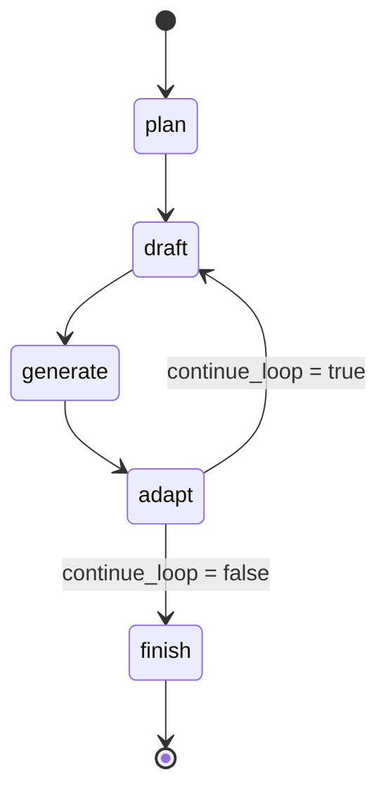

# Rapport — Orchestrateur LangGraph

> Version : v0.1 · Date : 18/11/2026 · Projet **Prolific**

---

## 1. Objectif

Prolific génère des images en masse via ComfyUI, piloté par un LLM (Ollama). Le rôle de
l'**orchestrateur** est de tenir un objectif (« N images » ou « T minutes ») de façon
résiliente, en orchestrant :

1. la rédaction des prompts (LLM + outil `search_terms`),
2. la génération (ComfyUI),
3. la gestion de la VRAM (swap LLM ↔ modèle d'image),
4. l'adaptation continue (calibration de durée, budget restant).

Le choix technique retenu : **LangGraph** (machine à états + checkpointing + retry),
exécuté en **graphe synchrone dans un thread en arrière-plan**.

---

## 2. Architecture globale

```
┌──────────────────────────── Prolific ────────────────────────────┐
│                                                                  │
│  (futur) Web UI / MCP ──► Orchestrateur (LangGraph)              │
│                              │                                   │
│              ┌───────────────┼───────────────┐                   │
│              ▼               ▼               ▼                   │
│        ChatOllama        RagIndex         ComfyUI                │
│        (rédaction)       (ChromaDB)       (génération)           │
│              │               ▲                                   │
│              └── search_terms ┘ (tool calling)                   │
│                                                                  │
│   SQLite (jobs/images/calibration)   +   checkpoints.sqlite      │
└──────────────────────────────────────────────────────────────────┘
```

Deux stockages distincts et complémentaires :

| Stockage | Rôle |
|----------|------|
| `prolific.sqlite` (module `db.py`) | état **domaine** : jobs, images, calibration — lu par l'UI/API |
| `checkpoints.sqlite` (LangGraph)   | état **d'exécution** : position du graphe, pour reprise |

---

## 3. Le schéma LangGraph

### 3.1 Graphe



Le graphe est un **cycle** : `plan` (une fois) → `draft` → `generate` → `adapt`, puis
`adapt` reboucle vers `draft` tant que l'objectif n'est pas atteint.

### 3.2 State (`OrchestratorState`)

Le state est un `TypedDict` (les champs sont optionnels, remplis au fil de l'eau).

| Champ | Type | Rôle |
|-------|------|------|
| `job_id` | `int` | identifiant du job en base |
| `objective` | `dict` | `{"type":"count","n":N}` ou `{"type":"duration","minutes":M}` |
| `theme` | `str` | thème du job |
| `workflow` | `str` | nom du workflow ComfyUI (clé du manifest) |
| `style` | `str` | format des prompts : `tags` \| `prose` \| `hybrid` |
| `orientation` | `str` | `carre` \| `paysage` \| `portrait` |
| `datasets` | `list[str]` | datasets RAG actifs pour ce job |
| `swap_vram` | `bool` | décharger/recharger les modèles autour des lots |
| `model` | `str` | modèle LLM (Ollama) |
| `seed` | `int \| None` | seed fixe (sinon aléatoire) |
| `batch_size` | `int` | nombre de prompts à rédiger pour le lot courant |
| `prompts` | `list[str]` | prompts du lot courant, à générer |
| `generated` | `int` | total d'images produites (cumul sur les lots) |
| `target` | `int \| None` | cible (mode « count ») |
| `deadline` | `float \| None` | timestamp de fin (mode « durée ») |
| `started_at` | `float` | timestamp de démarrage |
| `batch_durations` | `list[float]` | durées mesurées sur le dernier lot |
| `continue_loop` | `bool` | décision d'`adapt` : reboucler ou finir |
| `status` | `str` | `running` \| `done` \| `stopped` \| `failed` |
| `error` | `str \| None` | dernière erreur, le cas échéant |
| `stalled` | `int` | lots consécutifs sans nouveau prompt (garde anti-boucle) |

### 3.3 Nœuds

#### `plan` — dimensionnement du premier lot
- **count** : `target = n`, `batch_size = n`, pas de deadline.
- **duration** : `deadline = now + minutes×60 − marge (30 s)`. Si une calibration existe
  pour le workflow, `batch_size = budget / avg_seconds` ; sinon **lot de sonde de 3**.
- Sorties : `target`, `batch_size`, `deadline`, `started_at`, `generated=0`, `status="running"`.

#### `draft` — rédaction des prompts
- Vérifie la deadline **avant** de lancer (le temps de rédaction compte dans le budget).
- Injecte l'**historique** des prompts déjà générés dans ce job (soft, anti-répétition).
- Construit l'outil `search_terms` (si datasets actifs) et un `ChatOllama`.
- Appelle `draft_prompts_agent` (boucle LLM ↔ outils, max 6 itérations) avec
  `n = batch_size`, le thème, le style, les datasets et l'historique.
- Normalise la sortie (`normalize_draft`) puis **dédoublonne** (`dedupe`) contre
  l'historique et au sein du lot.
- Si aucun nouveau prompt n'est produit, incrémente `stalled`.
- En cas d'échec : pose `error` + `status="failed"` + `continue_loop=False`.
- Sorties : `prompts` (ou erreur), `stalled`.

#### `generate` — génération du lot
1. Si `swap_vram` : **décharge le LLM** (`ollama stop`) une fois, pour tout le lot.
2. Pour chaque prompt (arrêté par le stop, la deadline ou la cible) :
   - résout les dimensions (`resolve_format`) et patche le workflow (`patch_workflow`),
   - enregistre une image `pending` en base,
   - soumet à ComfyUI (`submit`), attend (`wait_for`), extrait les images,
   - passe l'image en `done` (chemin, durée) et incrémente `generated`.
3. `finally` : si `swap_vram`, **libère la VRAM ComfyUI** (`POST /free`).
- Sorties : `generated`, `batch_durations`, `prompts=[]`, `continue_loop=True`.

#### `adapt` — calibration + décision
- Met à jour la calibration (moyenne glissante par image, dans `db.py`).
- **count** : `remaining = target − generated` → si > 0, `batch_size=remaining` et reboucle ;
  sinon `status="done"`.
- **duration** : si deadline dépassée → `done` ; sinon recalcule `batch_size` depuis le
  budget restant et la calibration, et reboucle.
- Sorties : `batch_size`, `continue_loop`, éventuellement `status`.

#### `finish` — clôture
- Écrit le statut final (`done` / `stopped` / `failed`) + `finished_at` + `error` en base.

### 3.4 Arêtes

| Arête | Type |
|-------|------|
| `START → plan` | fixe |
| `plan → draft` | fixe |
| `draft → generate` | fixe |
| `generate → adapt` | fixe |
| `adapt → draft` / `adapt → finish` | **conditionnelle** : `continue_loop` |

La condition est triviale :

```python
@staticmethod
def _should_continue(state) -> str:
    return "draft" if state.get("continue_loop") else "finish"
```

### 3.5 Checkpointing & reprise

- Checkpointer : `SqliteSaver` (`checkpoints.sqlite`), `setup()` au démarrage.
- Le graphe est compilé avec `checkpointer=self._checkpointer`.
- Chaque exécution est identifiée par `thread_id = str(job_id)` → un checkpoint par job.
- Un job interrompu peut être **relancé** avec le même `thread_id` : LangGraph repart du
  dernier état checkpointé (reprise après crash). *(Câblé au niveau framework ; la reprise
  « propre » mid-batch sera affinée en v2 — voir §7.)*

### 3.6 Arrêt (stop)

- Un `threading.Event` par `job_id` (`_stop_events`).
- `stop(job_id)` pose l'Event.
- Le nœud `generate` le **consulte entre chaque image** : s'il est posé, il arrête le lot,
  met `status="stopped"` et `continue_loop=False` → le graphe va vers `finish`.
- Limitation assumée : le stop n'interrompt pas une rédaction LLM en cours (pris en compte
  au prochain passage dans `generate`).

### 3.7 Anti-répétition entre lots
Sans mémoire, le LLM répéterait des prompts d'un lot à l'autre (mode durée, lots de
rattrapage). Deux mécanismes complémentaires :

1. **Historique injecté (soft)** : `draft` passe au LLM les prompts déjà générés
   (`history_hint.txt`, tronqué à `MAX_HISTORY = 200`) avec la consigne de ne pas les
   répéter et de varier.
2. **Dédoublonnage déterministe (hard)** : `dedupe()` supprime les doublons exacts
   (vs historique et au sein du lot) après rédaction — indépendant du LLM.

Garde anti-boucle : si deux lots consécutifs ne produisent aucun nouveau prompt
(`stalled ≥ 2`), `adapt` termine le job proprement.

*(v2 : filtre de similarité par Jaccard sur les tags pour éliminer aussi les prompts
« presque identiques », pas seulement les doublons exacts.)*

---

## 4. Cycle de vie d'un job

### Mode « N images »
```
submit → plan(batch=N) → draft(N prompts) → generate(N images) → adapt → finish
```
Un seul lot. Si des images échouent, `adapt` redimensionne un lot de rattrapage
(`remaining = target − generated`) et reboucle.

### Mode « T minutes »
```
plan(sonde ou estimation) → draft → generate → adapt → draft → generate → … → finish
```
Boucle **planifier → exécuter → adapter** : chaque lot mesure sa durée réelle, met à jour
la calibration, et redimensionne le lot suivant selon le budget restant. Sans calibration
initiale, le premier lot est une sonde de 3 images.

---

## 5. Gestion VRAM (swap)

Le swap est **opt-in** (`swap_vram`), pertinent uniquement quand le LLM et ComfyUI
partagent le même GPU.

| Moment | Action |
|--------|--------|
| Début de `generate` | `ollama stop <model>` → VRAM libérée pour ComfyUI |
| Fin de `generate` (`finally`) | `POST /free` (`unload_models + free_memory`) → ComfyUI déchargé |
| `draft` suivant | le `ChatOllama` recharge implicitement le LLM |

**Principe clé** : un seul cycle VRAM par lot. On rédige tout le lot d'abord, puis on
génère tout — on limite ainsi les swaps coûteux.

---

## 6. Gestion d'erreurs

| Erreur | Comportement |
|--------|--------------|
| Échec de rédaction (LLM) | `status="failed"`, `error` posé, graphe → `finish` |
| ComfyUI injoignable (`submit`) | image `failed`, `status="failed"`, graphe → `finish` |
| Timeout / échec d'une génération | image `failed`, on **continue** le lot |
| Stop utilisateur | `status="stopped"`, graphe → `finish` |
| Exception inattendue dans `_run` | job `failed` + message en base |

La calibration n'est mise à jour qu'avec les durées des images réussies.

---

## 7. Limites connues & suites (v2)

- **Stop** : pas encore l'`interrupt()` natif de LangGraph (Event consulté entre images).
- **Reprise mid-batch** : le checkpointing est en place, mais la reprise « propre » après
  crash (sans re-générer) reste à affiner (idempotence du nœud `generate`).
- **Récupération des fichiers** : les chemins d'images sont stockés en base (relatifs au
  dossier de sortie ComfyUI), mais la copie/le service vers l'UI web reste à faire.
- **UI web + serveur MCP** : prochaines étapes (le MCP exposera `create_job`, `stop_job`,
  `get_job`, `list_workflows`, `list_datasets`, `search_terms`…).
- **Recherche obligatoire** : si l'on constate que le LLM n'appelle pas `search_terms`,
  on ajoutera une étape de recherche systématique injectée dans le prompt.

---

## 8. Modules impliqués

| Module | Responsabilité |
|--------|----------------|
| `orchestrator.py` | graphe LangGraph, nœuds, submit/stop, thread d'exécution |
| `agent.py` | boucle LLM ↔ outils (rédaction de N prompts) |
| `tools.py` | outil `search_terms` (tool calling) |
| `prompting.py` | templates de prompts + normalisateur |
| `rag.py` | indexation CSV → ChromaDB + recherche |
| `workflows.py` | manifest ComfyUI + injection des slots |
| `clients/ollama.py` | génération, embedding, déchargement |
| `clients/comfyui.py` | soumission, suivi, extraction, libération VRAM |
| `db.py` | persistance SQLite (jobs, images, calibration) |
| `config.py` | config `config.yaml` (pydantic) |
